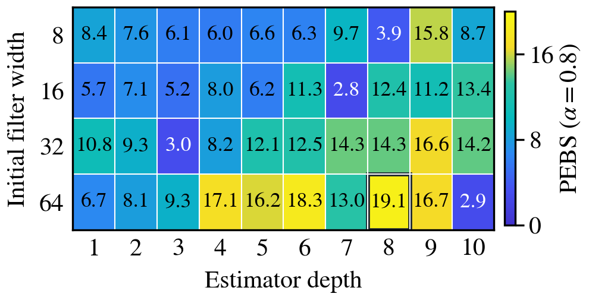

# FastSET

**Fast Sequential Retraining for Online Adaptation of Neural Receivers via
Physics-Guided Decomposition**

Shuo Wang, Facheng Hu, Hongzi Zhu, Yibo Pi, and Xudong Wang

Shuo Wang and Facheng Hu contributed equally. Corresponding author: Xudong Wang.

[](https://github.com/pardonhu/FastSET/actions)
[](LICENSE)

FastSET separates a neural receiver into a channel estimator and a demapper.
Online adaptation updates the estimator first and then the demapper when needed.
An offline search selects the split under the E2E receiver's parameter budget.

This is the authors' research implementation and reproducibility package for the
journal manuscript. [Paper information](docs/PAPER.md) ·
[Experiment catalog](docs/EXPERIMENTS.md) · [Reproduction guide](docs/REPRODUCING.md) ·
[Validation record](docs/RELEASE_STATUS.md)

## Reproduce the submitted figures

Python 3.10 is recommended. The figure workflow needs no TensorFlow or GPU.

```bash
git clone https://github.com/pardonhu/FastSET.git
cd FastSET
python -m venv .venv
source .venv/bin/activate
python -m pip install -e '.[test]'
python -m pytest
python scripts/reproduce_paper.py --output results/paper_001
```

The command rebuilds the main-paper, supplementary, and difference-summary
experimental figures from the **archived measurements**. CSV tables and editable
plotting sources are included in `paper/`. Each execution saves its source hashes,
logs, and PDFs in a new output directory. Use `--group main`, `supplement`, or
`differences` to rebuild one document's figures. Numerical data are retained at
full precision; changing a plotting style does not change measurements.

For the exact archived A2B input files, use the versioned
[data and model downloads](docs/REPRODUCING.md#1-exact-archived-a2b-inputs-and-pretrained-models).



## Run an experiment

The reference GPU environment uses TensorFlow 2.15.1, Sionna 0.19.2, NumPy 1.26.4,
and Python 3.10. Timing in the paper was measured on an RTX 3090 Ti.

```bash
conda env create -f environment.yml
conda activate fastset-research
python -m pip install -e '.[gpu,test]'
fastset doctor
python scripts/run_experiment.py --list
```

The following generates the A2B source/adaptation/validation/evaluation inputs and
runs online adaptation, a BER curve, and three timing replays. The source-trained
8–64 and E2E initial models are included in the repository.

```bash
# Inspect frame counts and estimated storage before generating a full dataset.
python scripts/prepare_data.py --case A2B --scale paper --gpu 0 \
  --output data/tdl --plan-only
python scripts/prepare_data.py --case A2B --scale paper --gpu 0 \
  --output data/tdl
python scripts/run_experiment.py --experiment A2B_d8_w64 \
  --manifest data/tdl/A2B_paper.json --data-root data/tdl \
  --gpu 0 --output results/A2B/run_001
```

Use `--pretrain` to train the source model first. Use `--source PREFIX` to supply
another compatible source-trained model, or download the archived model bundle
with `python scripts/download_assets.py --asset weights --output data/weights`.
A `--scale smoke` dataset is a short execution check, not a paper measurement.
A complete small execution check, including source pretraining, is:

```bash
python scripts/prepare_data.py --case A2B --scale smoke --gpu 0 --output data/smoke
python scripts/run_experiment.py --experiment A2B_d8_w64 \
  --manifest data/smoke/A2B_smoke.json --data-root data/smoke \
  --pretrain --smoke --gpu 0 --output results/smoke_001
```

Completed phases can be reused with `--resume`; configuration and input hashes
must match. All GPU jobs require an explicit device and use a cooperative lock.

### Experiment families

| Experiment | Catalog group | Data preparation |
|---|---|---|
| A2B, A2C, B2C; before/after BER and time | `main` | `A2B`, `A2C`, `B2C` |
| 40 splits, width/depth, PEBS and α | `pebs` | `A2B` |
| Est.1, Est.5, Est. only, Dem. only, Joint SP, Joint JP, E2E; three orders | `ablation` | `A2B`, `A2C` |
| Five learning rates; batch16/32/64 | `learning_rate`, `batch_size` | `A2B` |
| Adaptation training-set size, 8–64/9–32/E2E | `data_volume` | `A2B_volume_1` … `A2B_volume_100` |
| Transformer and MLP split/E2E | `backbone` | `A2B` |
| TDL delay spread and speed | `tdl_delay`, `tdl_speed` | matching case in catalog |
| Four RT cities, Paris positions, cross-city, RT delay | `rt` | matching RT case |
| E2E source pretraining budget | `pretraining` | `A2B`, `A2C` |

See the [figure-to-experiment index](docs/EXPERIMENTS.md) for supplementary
independent testing, source-domain evaluation, checking-cost estimates, fixed-time
comparisons, and the 5–16/8–64 comparison. Conventional LS, Perfect CSI, and
CNN-estimator baselines use `fastset baselines`.

## Protocol details that affect reproduction

- One **iteration** processes one online batch; one **epoch** traverses all source
  batches. Default batch size is 32 frames. One source epoch contains 96,000 frames
  over 4–18 dB. The batch-size experiment explicitly changes the online batch size.
- Source pretraining uses five estimator epochs and ten demapper epochs; E2E uses
  ten epochs. Joint JP uses separate ten-epoch joint pretraining with MSE+BCE.
- Main adaptation checks the initial model and every iteration, stopping at
  post-LDPC BER **strictly below `2e-4` at 12 dB**. Estimator and demapper stages
  have separate, explicit budgets.
- Offline PEBS search completes five estimator and twenty demapper iterations,
  evaluates all qualifying saved models on separate samples, and selects the
  maximum PEBS per split. This differs from main-experiment first-hit stopping.
- The estimator learns a residual over a pilot-based LS estimate. Its MSE label
  is the simulator's true channel; the demapper uses coded-bit BCE.
- Main TDL BER curves reuse the stopping-validation samples, with paired noise
  scaling over SNR. PEBS uses separate evaluation samples. The independent final
  check uses a further, fixed dataset. RT uses distinct adaptation/validation/test
  random streams at each fixed propagation geometry.
- Timing starts with a warmed, resident receiver reading adaptation data. Input
  processing and synchronized training are included; BER checks, model loading,
  compilation, and model saving are excluded. Checking-cost estimates are labeled
  separately. [Timing definition](docs/TIMING.md).

The archived CSV workflow regenerates the submitted numerical curves. A new
training run produces a separate result with its own data and software lineage.
Floating-point execution and GPU runtime affect training trajectories and timing;
[validation status](docs/RELEASE_STATUS.md) records the checks actually performed.

## Repository structure

```text
src/fastset/          shared models, link, training, evaluation, RT and statistics
configs/             experiment catalog, numerical settings and dataset recipes
paper/plotting/      final editable plotting code with embedded measurements
paper/tables/        exported numerical tables for independent analysis
artifacts/rt/        frozen RT propagation coefficients and SHA256 inventory
artifacts/checkpoints/  source-trained 8–64 and E2E initial states
scripts/             dataset preparation, experiment runner, downloads and audits
tests/               protocol, data isolation, metrics and artifact regressions
docs/                experiment index, model/data cards and validation record
results/             your outputs (excluded from Git)
```

No per-case copies of the neural receiver package are used. Model definitions,
data loading, optimizer steps, LDPC evaluation, and timing are shared across
experiments. Each run records configuration, seed, model/data/code hashes, integer
error counts, model states, progress, and logs.

## Citation and reuse

The code, author-generated measurements, and model artifacts are released under
[MIT](LICENSE). Dependency and scene notices are listed in
[THIRD_PARTY_NOTICES.md](THIRD_PARTY_NOTICES.md). See [CITATION.cff](CITATION.cff)
for the software citation and [paper information](docs/PAPER.md) for the manuscript
record. Questions and reproducibility reports are welcome through
[GitHub Issues](https://github.com/pardonhu/FastSET/issues).
