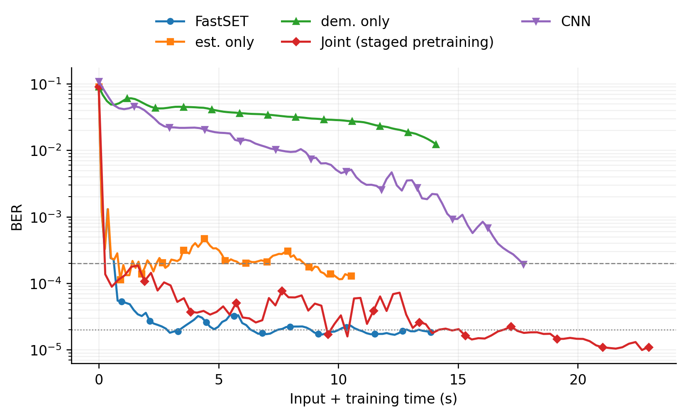

# FastSET

Research code for **FastSET: Fast Sequential Retraining to Accelerate Online
Adaptation for Neural Receivers**.

FastSET adapts an OFDM receiver by updating its channel estimator and neural
demapper separately. This repository contains shared receiver definitions,
explicit experiment configurations, measured CSV artifacts, and figure scripts.

**Public development snapshot; full experiment reproduction is not yet validated.** CPU checks and figure
reproduction can run without a GPU. The portable GPU orchestration requires a
numerical acceptance run before it is labeled validated. Dataset generation scripts are provided instead of uploading raw data.
The archived manifests are retained for provenance. See
[release status](docs/RELEASE_STATUS.md) for the remaining publication items.
No claimed artifact badge or acceptance status is implied.

## Quick start: reproduce plots

Use Python 3.10 in a separate environment:

```bash
python -m venv .venv
source .venv/bin/activate
python -m pip install -e '.[test]'
python -m pytest
python scripts/audit_release.py
fastset paper-figures --artifacts artifacts --output results/paper_figures
```

This uses **measured CSVs**, without training, GPU allocation, or downloading
the datasets. It recreates curve data and comparison plots; the layout is not
promised to be pixel-identical to a changing manuscript draft. A2C is the main
ablation; A2B is retained as a supplemental experiment.



The Joint curve above uses the common staged-pretrained checkpoint. The separate
Joint-pretraining control is not substituted into this snapshot.

## GPU experiments

The local reference environment is Python 3.10, TensorFlow 2.15.1, Sionna 0.19.2,
NumPy 1.26.4, and an NVIDIA RTX 3090 Ti. Remote experiments also used RTX 3090
and TensorFlow 2.14; cross-environment trajectories are not asserted bit-identical.
The installation below targets the local reference environment only.

```bash
conda env create -f environment.yml
conda activate fastset-research
python -m pip install -e '.[gpu,test]'
fastset doctor
fastset check --config configs/a2b_fastset.json
```

This installs user-environment libraries; it does not install or change a system
NVIDIA driver. See [environment notes](docs/ENVIRONMENT.md).

Generate the TDL data locally; the suite creates the source/target splits and
assembles A2B/A2C manifests automatically. Inspect the plan first (the full suite
is approximately 48 GB uncompressed):

```bash
fastset generate-suite --targets B C --scale paper --gpu 0 \
  --output data/tdl_v1 --plan-only
fastset generate-suite --targets B C --scale paper --gpu 0 --output data/tdl_v1
fastset check --config configs/a2b_fastset.json \
  --manifest data/tdl_v1/A2B.json --data-root data/tdl_v1 --verify-hashes
fastset online --config configs/a2b_fastset.json \
  --manifest data/tdl_v1/A2B.json --data-root data/tdl_v1 \
  --source artifacts/checkpoints/d8_w64/online_initial \
  --gpu 0 --output results/a2b/run_001
```

See [dataset generation](docs/DATA_GENERATION.md) for the small smoke option,
seeds, disk requirements and separate RT status. Regenerated inputs implement
the declared protocol but are not promised to match archived samples or every
published BER value. Full generation-to-results GPU acceptance is still pending.
The bundled initial checkpoints are existing source-pretrained weights with
reset online optimizer slots, not target-adapted weights.

For source pretraining, omit `--source` and use the `pretrain` command with the
same config/manifest/data-root arguments. All neural commands require an explicit
GPU and refuse a busy device or CPU fallback. Each command creates a fresh run
directory with configuration, code/input lineage, log, CSVs, and checkpoints.
Outputs are never silently reused. A failed run remains available for diagnosis.

## Repository map

| Path | Purpose |
|---|---|
| `src/fastset/` | Shared model, link, data, training, evaluation and plotting code |
| `configs/` | Main A2B/A2C protocols, 40 splits, ablations, and new TDL generation |
| `artifacts/tables/` | Frozen measured data for the current paper figures |
| `artifacts/checkpoints/` | Source-pretrained 8-64 and CNN online initial states |
| `artifacts/manifests/` | Relative-path dataset inventories |
| `artifacts/INDEX.json` | Artifact provenance, transformations and SHA256 digests |
| `tests/` | CPU protocol, data integrity, isolation and artifact tests |
| `docs/` | Reproduction, timing, data/model cards and release status |

## Experiment protocols

- `iteration` is one optimizer update on one stored batch of 32 frames.
  `epoch` traverses all source-training batches; the source dataset has 3,000
  batches across 4–18 dB.
- Source pretraining: estimator 5 epochs, demapper 10 epochs; CNN 10 epochs.
  The separate Joint-pretraining control uses joint MSE+BCE for 10 epochs.
- Main adaptation: check the initial state and each estimator/demapper iteration;
  stop at BER **strictly below** `2e-4`, or the declared iteration cap.
- Ablation: run all 50 A2B / 84 A2C iterations. Plot `2e-4` and `2e-5` as
  reference lines without stopping. Pretraining treatment is labeled explicitly.
- Estimator MSE uses simulator channel labels. The network receives an LS
  estimate and learns a residual; true channel labels are not receiver inputs.
- Validation and independent evaluation are separate roles. A validation hit
  does not imply the same BER on new samples or other SNRs.

See [reproduction instructions](docs/REPRODUCING.md),
[timing definitions](docs/TIMING.md), [data card](docs/DATA_CARD.md),
[model card](docs/MODEL_CARD.md), and [experiment coverage](docs/COVERAGE.md).

To recompute PEBS without retraining:

```bash
fastset pebs --alpha 0.8 --output results/pebs_alpha08.csv
```

The formula is `alpha * (BER_CNN / BER) + (1-alpha) * (time_CNN / time)`.
It uses fixed first-validation-hit checkpoints, independent seed57 BER, and
the declared CNN first-hit reference. Zero observed BER is not replaced with a
pseudocount to create an infinite or artificially large score.

## Citation and license

`CITATION.cff` identifies this software draft and its paper authors. A paper DOI,
software DOI, release URL, and final bibliographic entry will be added once
confirmed. No publication venue or acceptance is invented here.

The repository license is **awaiting author selection**. Until a license is
added, no open-source license grant is attached to this public snapshot.
See [third-party notices](THIRD_PARTY_NOTICES.md).

